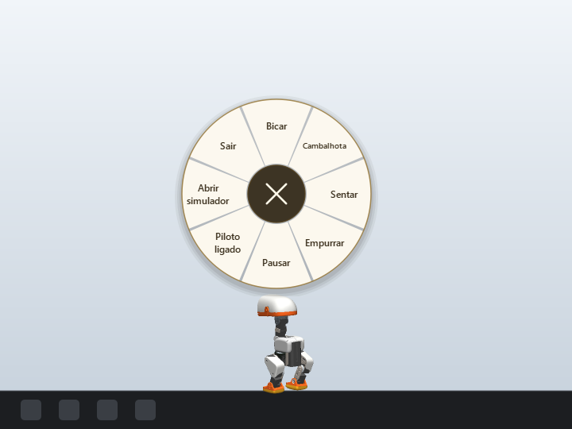

# 05: Modo mascote (pato na barra de tarefas)

O pato aparece de perfil, sem fundo, com os pés sobre a borda de cima da barra de tarefas, e
anda de um lado para o outro. Tudo o que não é o pato é transparente e deixa o clique passar
para o que está atrás.

## 1. Onde fica o "chão"

- Monitor **principal**. Retângulo da barra de tarefas via `SHAppBarMessage(ABM_GETTASKBARPOS)`;
  ocultação automática via `ABM_GETSTATE` (`ABS_AUTOHIDE`).
- **Barra embaixo e visível** (o caso normal no Windows 11): chão = borda de cima da barra.
- Barra oculta automaticamente, no topo ou nas laterais: chão = borda de baixo da área de
  trabalho do monitor principal (`QScreen.availableGeometry().bottom()`). Registre no log que é
  o modo degradado.
- Coordenadas: o Win32 devolve **pixels físicos**; o Qt trabalha em **pixels lógicos**. Converta
  com o `devicePixelRatio` da tela. Teste com 100 %, 125 % e 150 % de escala (M5).
- Recalcule tudo quando: `QScreen.geometryChanged`, `availableGeometryChanged`, mudança do
  monitor principal ou mudança do retângulo da barra (consulte a cada 2 s; é barato). Depois de
  recalcular, traga o pato para dentro da nova faixa (§4).

## 2. A janela

- `QWidget` de primeiro nível com `FramelessWindowHint | WindowStaysOnTopHint | Tool` (sem botão
  na barra de tarefas, sem aparecer no Alt+Tab) e `WA_TranslucentBackground`.
- Nunca rouba o foco: `WA_ShowWithoutActivating` e o estilo estendido `WS_EX_NOACTIVATE`.
- Clique atravessa os pixels transparentes. No Windows, uma janela em camadas com alfa 0
  deixa o clique passar; **comprove** isso no M5 clicando num ícone da barra de tarefas através
  da área transparente da janela. Se não funcionar, use `WM_NCHITTEST` → `HTTRANSPARENT` fora
  da máscara.
- **Sempre no topo, inclusive sobre a barra de tarefas:** a barra também é `TOPMOST` e passa à
  frente quando clicada. A cada 1 s chame
  `SetWindowPos(HWND_TOPMOST, …, SWP_NOMOVE|SWP_NOSIZE|SWP_NOACTIVATE)`.
- **Tela cheia:** se `SHQueryUserNotificationState` devolver `QUNS_BUSY`,
  `QUNS_RUNNING_D3D_FULL_SCREEN` ou `QUNS_PRESENTATION_MODE`, esconda a janela e **pause** a
  simulação. Volte quando acabar. Consulte a cada 1 s.
- Tamanho: quadrado de lado `S = 1.6 × H`, onde `H` é a altura do pato em pé, em pixels lógicos:
  **Pequeno 80**, **Médio 120** (padrão), **Grande 180**. O 1.6 dá folga para a cambalhota e
  para a cabeça. **Atenção:** 80/120/180 é a altura do **pato**, não da janela (Médio: S = 192).

## 3. Câmera e mapeamento sim ↔ tela

Revisado na ADR-0007, depois que a primeira versão cortou a cabeça do pato.

- Câmera **ortográfica de verdade**: `mjvCamera` livre com `model.vis.global_.orthographic = 1`,
  ligada só durante a renderização do mascote. Numa câmera ortográfica, o MuJoCo lê `fovy` como a
  **altura visível em metros**, não como um ângulo. Passar graus produz quadros pretos.
- **Vista 3/4**: azimute 140°, elevação −10°. Assim aparecem as duas pernas, a cabeça e o olho;
  num perfil puro, uma perna esconde a outra. Com o pato olhando para +x, a câmera o vê de
  frente-esquerda; ao virar, ele aparece de costas. Isso é 3D de verdade, não um sprite espelhado.
- `H_m` = altura do pato em pé **como a câmera o vê**: do ponto do chão sob o tronco até o vértice
  mais alto das malhas, medido ao longo do eixo "para cima" da câmera. É calculada em tempo de
  execução a partir das malhas (`render.mascot.duck_screen_height_m`) e dá **0,270 m**. A altura
  do tronco (0,1155 m) **não** serve.
- Pixels por metro: `ppm = H / H_m`. Altura visível da câmera: `S / ppm = 1.6 × H_m`.
- O pato anda ao longo do x do mundo. Na tela, um deslocamento `d` vira `(d · right) × ppm`,
  com `right = (sin 140°, −cos 140°, 0) ≈ (0.64, 0.77, 0)`:

  ```
  screen_x(x, y) = ground_center_px + (x * rx + y * ry) * ppm
  x_min_m        = (ground_left_px  + S/2 + 8 - ground_center_px) / (ppm * rx)
  x_max_m        = (ground_right_px - S/2 - 8 - ground_center_px) / (ppm * rx)
  ```

- Enquadramento por quadro (sem tremer): a janela fica em pixel inteiro,
  `left = round(screen_x − S/2)`. A câmera mira o ponto do chão sob o tronco, deslocado por
  `right × (resto do arredondamento / ppm)` e por `up × ((S/2 − m) / ppm)`. O pato cai na posição
  subpixel exata, e o chão sob ele fica sempre na linha `S − m` da janela.
- **Limites dependem da profundidade.** A vista 3/4 mapeia `(x, y)` para
  `center + (x·rx + y·ry)·ppm`: um pato fora da linha `y = 0` (empurrão, queda, cambalhota)
  desliza na horizontal. Os limites usados pelo piloto automático são recalculados a cada
  passo com `MascotMapping.x_limits_for_y(y)`; além disso, o enquadramento por quadro prende a
  janela dentro de `[band.left, band.right]` (`AppController._render_mascot_frame`). Assim o
  pato pode encostar na borda, mas **nunca sai do monitor**; o arrasto também é limitado à
  faixa.

## 4. Entrar no modo mascote

1. Reset do pato (03 §7) em `x = settings.mascot_last_x` (ou 0 na primeira vez), limitado a
   `[x_min_m, x_max_m]`, `y = 0` e guinada sorteada em `[-0,7 rad, 0]` — sempre virado para a
   câmera (azimute 140°, ADR-0007 e ADR-0009).
2. A bola é estacionada fora de cena: `(0, 50, 0.035)`, com velocidade zerada.
3. O piloto automático começa em `IDLE`.
4. Se o pato for parar fora da faixa (cambalhota perto da borda, mudança de resolução), faça um
   **reset suave** no limite mais próximo, 0,1 m para dentro.

## 5. Piloto automático (`brain/autopilot.py`)

Máquina de estados determinística, com `numpy.random.Generator` injetado, testável sem janela.

| Estado | O que faz | Sai para |
|---|---|---|
| `IDLE` | Comando zerado por 2–6 s. A cabeça "olha em volta": alvos aleatórios de head_yaw ∈ ±0.6 e head_pitch ∈ ±0.3 rad, trocando a cada 1–2 s, com rampa de 1 rad/s. Cada olhada abre o bico "um tiquinho" (§6, ADR-0010). Antes de ficar parado, se o erro de rumo passar de 0,5 rad o pato vira para a câmera (ADR-0009) | sorteio: `WALK` 55 %, `SIT` 15 %, `PECK` 15 %, `IDLE` 10 %, `ROLL` 5 %; rumo errado → `TURN` |
| `WALK` | Escolhe um alvo x a pelo menos 0,5 m de distância, dentro da faixa. Anda com vx ∈ [0.28, 0.30] para a direita e **de ré** com vx ∈ [-0.30, -0.28] para a esquerda, sempre com a frente para a câmera (ADR-0009; a velstand treina vx em [-0.3, 0.3]). Controle de rumo abaixo. | chegou (\|Δx\| < 0.05 m) → `IDLE` |
| `TURN` | Gira no lugar até o rumo desejado — sempre ~0 rad, a frente para a câmera: `wz = ±1.5` (liga-desliga; abaixo de ~1,0 a velstand parada não gira, ADR-0006) | \|erro\| < 0.15 rad → volta ao estado anterior |
| `SIT` | Pede `SIT`, fica sentado 5–20 s e pede `STAND` | fim da subida (03 §8) → `IDLE` |
| `PECK` | Pede `PECK` | fim do episódio → `IDLE` |
| `ROLL` | Pede `ROLL`, só se tiver ≥ 0,4 m livres à frente e a última cambalhota tiver sido há ≥ 3 min; senão vira `IDLE` | fim → `IDLE` |
| `RECOVER` | O pato caiu (tronco > 45° da vertical): comando zerado e espera a velstand levantar | em pé por 1 s → `IDLE`; o watchdog (02) reseta depois de 6 s |

**Controle de rumo** (`WALK`, `TURN`), com `yaw` sendo a guinada do tronco. Desde a ADR-0009 o
pato **nunca vira de costas para a câmera**: `yaw_ref` fica em ~0 rad e o trajeto para a
esquerda é feito andando de ré (`vx < 0`).

```
vx_sign = +1 se target_x > x, -1 se à esquerda
yaw_ref = clip(-0.8 * y * vx_sign, -0.3, 0.3)        # sempre ~0; o sinal de vx inverte a correção de y
err     = wrap(yaw_ref - yaw)
wz      = clip(2.0 * err, -1.0, 1.0)
vx      = 0 if |err| > 0.4 else v_walk * vx_sign     # primeiro vira, depois anda (de ré à esquerda)
```

- Se o pato estiver a menos de 0,15 m do limite e se movendo para fora, o alvo muda para o lado
  oposto (vira `TURN`, que agora só alinha a frente ~0 rad).
- Os pedidos passam pelas mesmas regras de 03 §8. O piloto automático **nunca** contorna as
  regras.
- Opção de menu "Piloto automático" desligada: o pato fica em `IDLE` para sempre, mas ainda
  reage a cliques.

## 6. Interação com o mouse

| Gesto | Efeito |
|---|---|
| Clique sobre o pato | Reação sorteada: bicar 40 %, sentar/levantar 30 %, cambalhota 15 % (mesmas condições do `ROLL`), olhar para o cursor 15 % (head_yaw para o lado do cursor por 2 s) |
| Duplo clique | Toca o **`chirp` gerado** — a vocalização sintetizada da instalação (`platform/voice/`, ADR-0011), e o bico trabalha no ritmo do som (lip-sync da envolvente da variante tocada, ADR-0010) com um leve sacode de cabeça; sem voz, cai no `quack.mp3` empacotado via MCI (`platform/sound.py`). Abrir o simulador é só pela bandeja ou pela roda (§7/§11) |
| Arrastar (botão esquerdo, > 6 px) | "Pega" o pato: a simulação pausa e a janela segue o cursor na horizontal (e até 200 px para cima, só visual). O arrasto toca o **wheee** (loop enquanto segura, aterrissagem ao soltar, ADR-0011). Ao soltar: reset em pé no x solto (limitado à faixa), com o mesmo sentido em que estava |
| Botão direito sobre o pato | Abre a roda de ações do pato, acima da cabeça (§11) |

"Sobre o pato" = pixel com alfa > 0 na última imagem renderizada.

### O bico (`brain/beak.py`, `SimCore.set_beak`, ADR-0010)

No robô real a mandíbula tem servo próprio (o 15.º servo, `MOUTH_INDEX`, fora de toda política);
o MJCF empacotado modela a mandíbula como geometria rígida, então o DuckDesk posa os geoms do
bico em tempo de execução — sem juntas nem atuadores novos, a observação de 61 D e as 14 ações
ficam intactas. As fontes do upstream que o mascote reproduz:

- **Grasno com bico e sacode de cabeça** (`autonomous.md`: "one to four chirps, with the mouth
  and a head toss"): a abertura segue a envolvente RMS do próprio `quack.mp3` (o mesmo truque
  do coro, que mapeia vogal → boca, `robotd/main.rs`).
- **Olhadas abrem o bico "um tiquinho"** (`robotd/idle_head.rs`): cada olhada do `IDLE` abre
  `glance_mouth = 0,4 × rng(0,5, 1)`, acompanhando o progresso da olhada.
- **Bocejo depois de quietude** (`idle_head.rs`/`robotd-params`): após ~45 s sem se mover
  (`IDLE` ou `SIT`, qualquer movimento ou interação zera o relógio), uma moeda por tick dá um
  bocejo a cada ~90 s: 3 s de abertura até `yawn_open = 0,6` (abre devagar, sustenta, fecha
  mais rápido) com a cabeça tombando `yawn_pitch = -0,15 rad`.

### A voz (`platform/voice/`, ADR-0011)

O pato **fala**: em vez de um MP3 fixo, o DuckDesk sintetiza a voz em tempo real, como o
daemon `sounds/` do projeto original — uma semente única por instalação
(`settings["voice_seed"]`, sorteada no primeiro boot) deriva uma personalidade vocal
(tom, nasalidade, vibrato, quackiness, tempo), e cada evento toca uma "tag" sintetizada
com variantes, para não soar como gravação:

| Evento | Tag | Onde |
|---|---|---|
| entrar no modo mascote | `greet` | o pato "acorda" falando |
| duplo clique | `chirp` | o "Quack!" — variante sorteada a cada vez |
| bicar (roda/bandeja/clique) | `peck` | e também como "tchau" antes do Sair/Ctrl+C |
| bocejo (quietude ~45 s) | `coo` | soninho |
| olhadas do IDLE e olhar-por-clique | `inquire` | moeda ~15 % por olhada |
| queda (RECOVER) | `alarm` | |
| arrasto | `wheee` | loop enquanto segura + aterrissagem ao soltar |

Tudo local e offline: os WAVs são renderizados uma vez por instalação no banco
`%APPDATA%/DuckDesk/voice/` (regenerado se a semente ou a versão do sintetizador mudar)
e o bico acompanha a envolvente do som tocado. **"Voz do pato"** na bandeja desliga ao
vivo (`settings["voice"] = false`); `DUCK_IDENTITY` fixa a identidade em depuração.

### Os ouvidos (`platform/ears.py`, `brain/voice_commands.py`, ADR-0012)

O pato também **ouve comandos falados em português** — recurso do DuckDesk, sem
equivalente no upstream (o robô real só detecta cafuné e sons ambiente, nunca
palavras). Reconhecimento 100 % offline pelo Vosk (`vosk-model-small-pt-0.3`,
empacotado) com **gramática restrita**: só as frases da tabela existem para o
reconhecedor — conversa alheia cai no `[unk]` e é ignorada.

| Frases | Efeito |
|---|---|
| `senta`, `sentar` · `levanta`, `levantar` | Sentar/Levantar (como a roda) |
| `anda`, `andar`, `vai` · `vem`, `vem aqui` | Liga o piloto (mascote) ou impulso de avanço (simulador) |
| `para`, `parar`, `quieto` | Para o impulso / desliga o piloto |
| `pirueta`, `cambalhota`, `rola`, `mortal` | Cambalhota |
| `bica`, `bicar` | Bicar o chão |
| `chuta`, `chutar`, `chuta a bola` | Chute, alternando pernas |
| `pia`, `grasna`, `fala` | `chirp` com lip-sync |
| `dorme`, `dormir`, `vai dormir` | Senta, boceja e resmunga `coo` |
| `olha`, `olha aqui`, `aqui` | Olhada para o lado + `inquire` |
| `pato`, `oi pato` | Chamar a atenção — responde `inquire` |
| `tchau`, `adeus` | O `peck` de despedida do robotd |

Cada comando aceito pisca o bico (o "ouvi"). Vale nos dois modos — no simulador
os comandos de movimento viram impulsos de `twist` no mesmo ponto do teclado.
**"Ouvido do pato"** na bandeja liga/desliga o microfone ao vivo
(`settings["ears"]`); sem modelo, sem microfone ou sem permissão do Windows o
pato fica surdo sem erro.

## 7. Menu da bandeja

O menu abaixo é o **QMenu nativo do ícone da bandeja** e não muda: ele é aberto pelo próprio
`QSystemTrayIcon`, inclusive quando o ícone está na área de **ícones ocultos** da barra. O
botão direito sobre o **pato** abre a roda de ações (§11), não este menu.

- **Abrir simulador**
- **Mostrar pato na barra** / **Esconder pato** (alterna)
- **Comportamentos** ▸ Sentar/Levantar · Bicar o chão · Cambalhota
- **Piloto automático** (marcável, ligado por padrão)
- **Voz do pato** (marcável, ligada por padrão): voz gerada por semente (§6, ADR-0011)
- **Ouvido do pato** (marcável, ligado por padrão): comandos de voz pt-BR offline
  (§6, ADR-0012)
- **Pausar**
- **Tamanho** ▸ Pequeno · Médio · Grande
- **Iniciar com o Windows** (marcável): escreve ou apaga
  `HKCU\Software\Microsoft\Windows\CurrentVersion\Run\DuckDesk`
- **Sobre e licenças**
- **Sair**

Clique simples no ícone: mostra ou esconde o pato. Dica do ícone: "DuckDesk".

## 8. Voltar ao simulador

Pela bandeja ou pelo item "Abrir simulador" da roda de ações (§11):

1. esconde a janela do mascote e para o piloto automático;
2. **não** reseta: o pato continua de onde está no mundo 3D, com a câmera seguindo-o;
3. mostra o simulador; o comando do teclado começa em zero;
4. salva `settings.mascot_last_x` e `settings.last_mode = "simulator"`.

Ao abrir o app, ele volta ao último modo usado. Na primeira execução, abre no simulador.

## 9. Renderização do mascote

Revisado na ADR-0007.

- `mujoco.Renderer` com `2·S_px × 2·S_px`, onde `S_px` é o tamanho da janela em pixels
  **físicos**. O MSAA do GL fica desligado só nesse renderizador (`offsamples = 0` na criação):
  a suavização das bordas vem da superamostragem 2×.
- Só o pato é desenhado: `geomgroup` só com o grupo 2 (malhas visuais), porque o chão e a bola
  estão no grupo 0. Sem céu, névoa, neblina, sombra nem reflexo.
- A transparência sai do **buffer de profundidade do mesmo quadro**: pixel vazio = plano
  distante. Uma passada de cor e uma leitura de profundidade da mesma cena, **em todo quadro**.
  Não use máscara atrasada nem atualizada "a cada N quadros": é isso que deixava pedaços pretos
  e cortes.
- Filtro 2×2 em inteiros sobre as amostras cobertas, gerando BGRA pré-multiplicado. Só o
  retângulo que contém o pato é processado.
- **30 fps sempre**, inclusive parado. Abaixo disso o andar parece travado. No tick de 8 ms, o
  limite efetivo é `1/30 − 4 ms`, senão o quadro cai em 40 ms (25 fps).
- Custo medido: cerca de 2,4 ms por quadro com `S = 192` (Médio). O app inteiro no modo mascote
  fica em ~25 % de um núcleo.
- Opcional: sombra elíptica suave sob os pés, desenhada pelo Qt, com alfa 0.25.

## 10. Critérios visuais (verificados no M5 com vídeo)

1. O pato aparece **inteiro**, da cabeça aos pés, em qualquer comportamento (andar, sentar,
   bicar, cambalhota), e os pés tocam a borda da barra: nem flutuam, nem afundam mais de 2 px.
2. Sem halo de cor do chão ou do céu em volta do pato.
3. Ao andar, a janela acompanha o pato sem tremer e sem atraso perceptível.
4. Os ícones da barra de tarefas e as janelas atrás continuam clicáveis fora do pato.
5. Ele vira e volta nas bordas, sem sair da tela.
6. Um app em tela cheia (vídeo no navegador em F11) esconde o pato; ao sair, ele volta.

## 11. Roda de ações do pato (pós-M7)

O botão direito **sobre o pato** não abre mais o menu da bandeja: abre uma roda de ações
desenhada pelo Qt, logo acima da cabeça. O menu nativo (§7) continua no ícone da bandeja,
inclusive na área de ícones ocultos. A decisão está na ADR-0008.

- **8 setores**, no sentido horário a partir do topo: **Bicar** · **Cambalhota** ·
  **Sentar/Levantar** · **Empurrar** · **Pausar/Continuar** · **Piloto ligado/desligado** ·
  **Abrir simulador** · **Sair**.
- O **centro** (✕) fecha a roda; `Esc` e um clique fora também fecham, como num menu normal.
- Rótulos dependentes de estado são recalculados a cada abertura: "Sentar"/"Levantar",
  "Pausar"/"Continuar", "Piloto ligado"/"Piloto desligado". Ações proibidas pelas regras de
  03 §8 ("Bicar"/"Cambalhota" sentado ou durante um movimento) aparecem **em cinza** e não
  disparam; a roda continua aberta, como um item desabilitado de menu nativo.
- **Posição:** a base da roda fica 10 px acima do topo da cabeça e centrada nela. O ponto vem
  da máscara alfa do último quadro (`MascotWindow.duck_head_point`), então acompanha a pose;
  antes do primeiro quadro usa a geometria de §3. A roda é presa à área de trabalho do monitor,
  sem cobrir a barra de tarefas.
- **Raio:** `round(0,62 × S)` px lógicos, limitado a 100–128 px. No tamanho Médio (S = 192) o
  raio é 119 px.
- **Implementação:** `ui/radial_menu.py` (`RadialMenu`, `WheelAction`); a ligação fica em
  `AppController.duck_wheel_actions`/`_show_duck_wheel`. Popup do Qt na mesma thread (ADR-0003),
  sem dependência nova.
- "Empurrar" usa o mesmo `on_push` do simulador (04 §5): impulso lateral de 2 N por 0,1 s,
  removido depois de 0,1 s também no modo mascote (o `_apply_push` roda no passo de controle
  dos dois modos). "Abrir simulador" e "Sair" chamam o mesmo caminho da bandeja (§8).

Prévia (pato e roda renderizados pelo app, sobre um fundo neutro):


