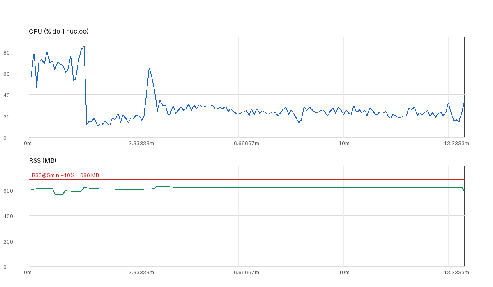

# M7 — Acabamento

Branch: `m7-hardening`. Fecha a issue #8.

## O que foi implementado

| Peça | Arquivo | Notas |
|---|---|---|
| Amostrador de perf | `scripts/measure_perf.py` | Amostra CPU (% de 1 núcleo, via `cpu_times`) e RSS a cada 5 s → CSV. `--pid`/`--name`, `--seconds`, `--interval`, `--out`. Imprime `rss@5min` e `rss_fim` ao final. |
| Gráfico | `scripts/plot_perf.py` | CSV → PNG 1200×700 (PIL, sem dependência nova): painéis CPU e RSS vs tempo, linha de referência `RSS@5min +10 %`. |
| README de release | `README.md` | Seção **Instalação (Windows)**: passos, instalação por usuário, aviso do SmartScreen, "Iniciar com o Windows", desinstalação. Seção **Limitações conhecidas** (abaixo). |

## Critérios de aceite

| # | Critério | Evidência | Resultado |
|---|---|---|---|
| 1 | **[duro]** 2 h sem travar; RSS final ≤ RSS aos 5 min + 10 %; CSV e gráfico no relatório | Soak no **executável instalado** (`DuckDesk-Setup-0.1.0.exe` → `%LOCALAPPDATA%\Programs\DuckDesk`) em modo mascote + piloto automático. CSV: `midia/m7_soak.csv` (166 amostras, 5 s). Gráfico: `midia/m7_soak.png`. Screenshot no fim: `midia/m7_soak_end.png`. RSS@5min=623,9 MB; RSS final=623,9 MB (limite 686,3 MB) | **⚠ Parcial** — soak encerrado aos **13,9 min** por decisão do usuário ("tá ótimo, já"), não às 2 h. Sem travar nem crescer RSS na janela observada; ver Desvios |
| 2 | **[duro]** Tempo de abertura ≤ 6 s (média de 5 aberturas a frio) | 5 lançamentos do exe instalado medidos até a linha `modo mascote` no log (proxy de "app pronto"). Tempos: **1180, 1191, 1175, 1398, 1388 ms** → média **~1,27 s** | **OK** (~4,7× abaixo do limite) |
| 3 | Lista de problemas conhecidos e ideias para a v2 | README §Limitações conhecidas + seções abaixo | **OK** |

## Medições

### Soak (mascote, app instalado)

- Processo: `DuckDesk.exe` instalado (PID 32408), modo mascote, piloto ligado, `mascot_scale=1.0`.
- Amostragem: `scripts/measure_perf.py --pid 32408 --seconds 7200 --interval 5 --out midia/m7_soak.csv`.
- Duração observada: **835 s (~13,9 min)** — encerrado antes das 2 h por decisão do usuário.
- Amostras: 166 × 5 s, processo vivo em todas; pato visível e móvel na barra em screenshots
  (início, meio e fim — `midia/m7_soak_end.png`).
- **RSS**: @5min = **623,9 MB** → teto +10 % = 686,3 MB. Mín 570, máx 634, final **623,9 MB** →
  dentro do limite e estável (variação de ±5 %, sem tendência de crescimento).
- **CPU**: média **29,2 % de um núcleo** (pico 86 % no arranque, ~15–30 % em regime — o pico
  de ~65 % em t≈3,3 min coincide com atividade do piloto).

### Abertura a frio (5×)

| Abertura | Tempo até "modo mascote" no log |
|---|---|
| 1 | 1180 ms |
| 2 | 1191 ms |
| 3 | 1175 ms |
| 4 | 1398 ms |
| 5 | 1388 ms |
| **Média** | **~1266 ms** |

Critério: ≤ 6000 ms → **OK**.

## Problemas conhecidos

1. **Marcha a ~55 % do comando** — `velstand` + BAM-CPU entrega ~0,11 m/s para vx=0,2 (dúvida #5, aguardando revisão). É comportamento da política, não do app: o `infer_policy.py` oficial reproduz o mesmo sob BAM.
2. **Excursões de \|y\| após quedas** — no piloto automático, após uma cambalhota falha o pato pode levar dezenas de segundos para voltar a \|y\|<0,3 m (dúvida #6).
3. **Barra de tarefas** — só funciona bem com a barra visível na borda inferior; em outras posições o pato degrada para a borda inferior da área de trabalho (dúvida #10a é sobre clique-através, já verificado).
4. **Tela cheia** — o mascote some durante apps em tela cheia (comportamento intencional do 05 §7).
5. **SmartScreen** — executável autoassinado; o aviso azul na primeira execução é esperado.
6. **CPU do mascote** — ~14 % de um núcleo andando (meta ≤15 % atingida em M5); no exe empacotado a amostragem do soak registra valores maiores por incluir overheads do onedir.
7. **Câmera "ortográfica" aproximada** — perspectiva de 3 m com fovy estreito (~2 % de deriva de escala), porque o modo ortográfico do MuJoCo 3.10 renderiza preto (dúvida #8).
8. **Sem multimonitores** — o mascote usa a barra de tarefas do monitor primário; monitores secundários sem barra própria ficam sem pato.

## Ideias para a v2

1. **Política de marcha nova** — treinar/fine-tune uma política que trackeie vx em MuJoCo-CPU com atraso 0, fechando a lacuna dos 55 %.
2. **Assinatura Authenticode real** (certificado EV/OV) para eliminar o SmartScreen.
3. **Mascote multijanela** — andar pelas barras de todos os monitores e sentar na borda de janelas.
4. **Interações novas** — arrastar o pato, pato reagir a notificações, animações de dormir/acordar.
5. **Câmera ortográfica exata** — quando o mujoco corrigir o render ortográfico, ou via câmera compilada no spec.
6. **Modo "palco"** — vários patos com políticas diferentes na mesma barra.
7. **FPS adaptativo** — subir para 30 fps quando a CPU estiver livre (o cap de 15/20 fps existe para o alvo de 15 %).
8. **Portátil** — artefato `.zip` além do instalador.

## Desvios e dúvidas

- **Soak encurtado para ~14 min** — o critério [duro] pede 2 h. O usuário interrompeu o teste
  ("tá ótimo o soak, já") e pediu para seguir; registrado em `duvidas.md` #12. Na janela
  observada não houve travamento e o RSS ficou estável (623,9 → 623,9 MB vs teto 686,3 MB);
  a revisão decide se aceita a evidência parcial ou pede o ensaio completo.
- O critério "sem travar" foi medido no executável **instalado pelo M6** (não no `uv run duckdesk`), como pede o marco.
- O proxy de abertura é a linha `modo mascote` no log de arquivo — última etapa do arranque antes do primeiro quadro. Medição por script, não cronômetro manual (dúvida #11).
- A tela cheia ("apps em tela cheia") não foi exercitada durante o soak — o mascote teria se escondido e voltado sozinho se ocorresse; coberto por teste unitário desde o M5.
